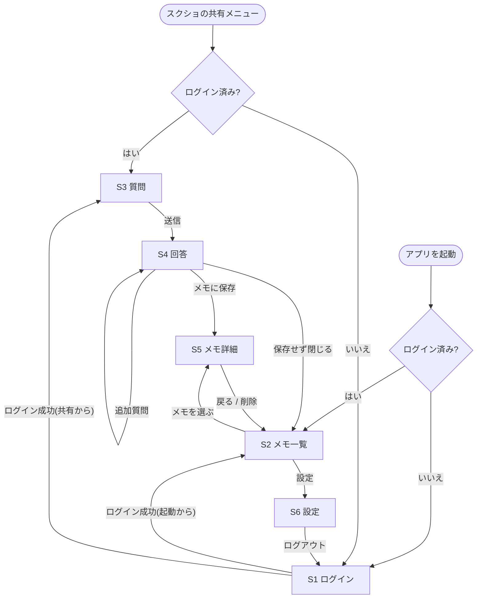
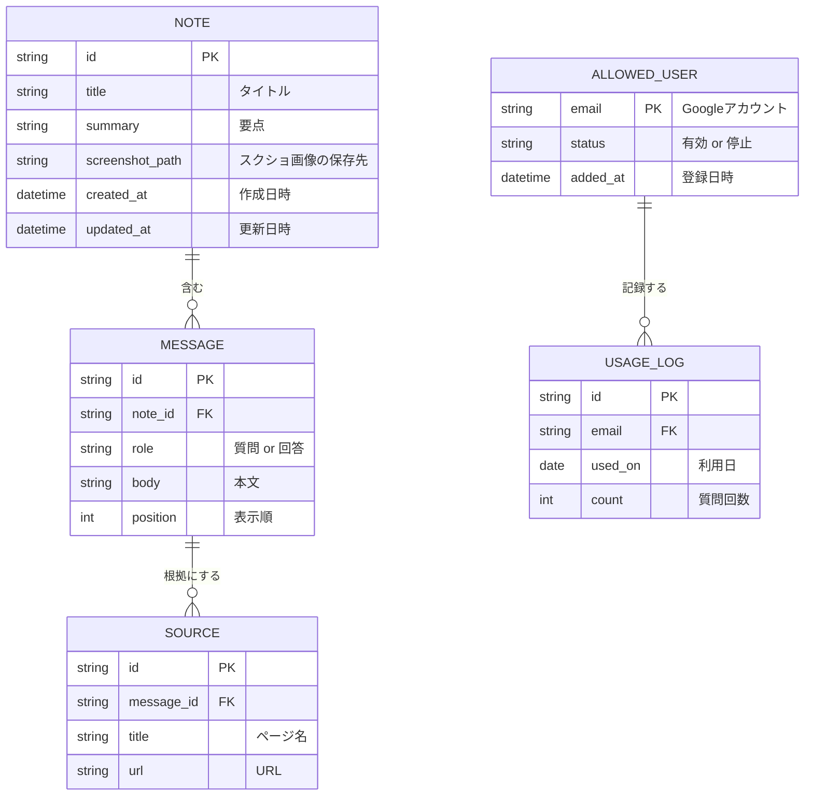

# PRD: スクショ質問アプリ(仮称)

- 版: 0.2(実装反映版。0.1 からの変更点は末尾の「変更履歴」を参照)
- 作成日: 2026-11-25
- 対象: 第1リリース(MVP)

---

## 1. 概要

Androidでスクリーンショットを撮った直後に、その画像についてAIへ質問できるアプリ。AIはWebの情報を調べたうえで、出典を示しながら、ユーザーが理解できる言葉で説明する。理解できた内容はメモとしてアプリ内に蓄積する。

| 項目 | 内容 |
|---|---|
| 種類 | 自分と近しい仲間向けのクローズドなアプリ |
| プラットフォーム | Android(スマートフォン) |
| 新規/置き換え | 完全新規 |
| 開発体制 | 1人、期限なし |
| 設計方針 | シンプルで洗練されたUI。目的に直結しない機能は入れない |

## 2. 背景と課題

- スクショで気になる情報を残しても、AIアプリを開いて画像を貼り直す手間があり、結局調べないまま流れてしまう
- AIの回答に根拠が示されないと、正しいかどうかを自分で確かめにくい
- 調べて理解した内容が残らず、同じことを何度も調べ直してしまう

## 3. ユーザー

ユーザーは1種類。権限の区別は「管理者(開発者本人)」と「利用者(仲間)」のみで、アプリ上の機能は同じ。

**ペルソナ**: 開発者本人とその仲間数名。スマホで記事、SNS、アプリ画面、資料などを見ていて、分からない用語や内容に出会うことが多い。調べる意欲はあるが、手順が多いと後回しにしてしまう。

## 4. ゴールと成功の定義

| 指標 | 目標 |
|---|---|
| 質問までの手数 | スクショ撮影後、2タップ以内で質問を送信できる |
| 回答の根拠 | すべての回答に出典リンクが1件以上付く(Webで根拠が見つからない場合はその旨を明示) |
| 回答の速さ | 送信から5秒以内に回答の表示が始まる(目安) |
| 学びの蓄積 | 回答から1タップでメモに保存でき、後から検索して見返せる |

## 5. スコープ

### 5.1 第1リリースに含める(Must)

| # | 機能 | 説明 |
|---|---|---|
| F1 | Googleログイン | Googleアカウントでログインする |
| F2 | アクセス制御 | 許可リストに登録されたアカウントだけが利用できる |
| F3 | スクショの受け取り | スクショの共有メニューからこのアプリを選ぶと、質問画面が開く |
| F4 | 質問 | 質問を入力して送信する。未入力の場合は「この内容を説明して」として送信する |
| F5 | 根拠付き回答 | AIがWebを調べ、出典リンク付きで回答する。専門用語には補足を付け、前提知識がなくても読める説明にする |
| F6 | 順次表示 | 回答を書き出しから順に表示する |
| F7 | 追加質問 | 同じスクショについて続けて質問できる |
| F8 | メモ保存 | 回答をメモとして保存する。タイトルと要点はAIが下書きする |
| F9 | メモの閲覧 | メモの一覧、詳細、キーワード検索、削除 |
| F10 | 設定 | ログイン中のアカウント表示、ログアウト |

### 5.2 余力があれば(Should / Could)

| 優先度 | 機能 | 補足 |
|---|---|---|
| Should | スクショ撮影の検知 | 撮影を検知して通知を出し、通知から質問画面を開く。Androidの制約の確認が必要(9章)。**未実装** |
| Should | メモの編集 | タイトルと要点を手で直す。**実装済み** |
| Should | 利用上限 | 1人あたり1日の質問回数に上限を設け、費用の急増を防ぐ。**実装済み**(初期値 50回/日) |
| Could | メモの書き出し | バックアップや機種変更のための書き出し。**未実装** |

### 5.3 含めない(Won't)

- 仲間同士でのメモ共有、コメントなどのSNS的機能
- クラウド同期、複数端末での利用
- タグ、フォルダ、お気に入りなどの整理機能
- スクショ以外の入力(音声、PDF、カメラ撮影)
- iOS、Web版

## 6. 画面

### 6.1 画面一覧

| # | 画面 | 役割 |
|---|---|---|
| S1 | ログイン | Googleログイン。許可されていないアカウントにはその旨を表示 |
| S2 | メモ一覧 | アプリ起動時の画面。メモを新しい順に表示、上部に検索欄 |
| S3 | 質問 | 受け取ったスクショと質問入力欄。送信ボタン1つ |
| S4 | 回答 | 会話形式で回答を表示。出典リンク、追加質問欄、メモ保存ボタン |
| S5 | メモ詳細 | スクショ、要点、質問と回答、出典 |
| S6 | 設定 | アカウント表示、ログアウト、バージョン |

実装では、S3 と S4 は1つの画面にまとめている(送信前は S3、送信後は同じ画面が S4 の表示になる)。

### 6.2 画面遷移図

### 6.3 UI方針

- 1画面に主要な操作は1つ。質問画面は「スクショ・入力欄・送信」だけにする
- 文字の読みやすさを最優先(十分な行間、落ち着いた配色、ライト/ダーク両対応)
- 出典は回答の本文中に番号で示し、末尾にリンク一覧をまとめる
- 装飾的なアニメーションや、目的に関係しないメニューは置かない

## 7. データモデル

### 7.1 エンティティ

| エンティティ | 保存場所 | 内容 |
|---|---|---|
| メモ(Note) | 端末 | 保存した学び1件。スクショ、タイトル、要点を持つ |
| 発言(Message) | 端末 | メモに含まれる質問と回答の1往復ずつ |
| 出典(Source) | 端末 | 回答の根拠としたWebページ |
| 許可ユーザー(AllowedUser) | サーバー | 利用を許可したGoogleアカウント |
| 利用記録(UsageLog) | サーバー | 利用上限の判定に使う回数の記録(Should) |

保存していない会話は、画面を閉じた時点で破棄する。

### 7.2 ER図

## 8. 非機能要件

### 8.1 認証とセキュリティ

| 項目 | 要件 |
|---|---|
| 認証 | Googleアカウントによるログイン |
| 利用者の制限 | サーバーが保持する許可リストに載ったアカウントのみ利用可。合言葉や共有パスワードは使わない |
| 本人確認 | ログイン時に、サーバーがGoogle発行のログイン証明(署名・発行元・宛先・期限・メール確認済み)を検証し、サーバー専用のセッション(30日)を発行する。アプリ側の自己申告は信用しない |
| 許可の確認 | セッションが有効でも、リクエストごとに許可リストを引き直す |
| 端末での保管 | セッションは端末のキーストアの鍵で暗号化して保存する |
| AIのキー | サーバーにのみ保管する。アプリには含めない |
| 通信 | すべて暗号化(HTTPS) |
| 利用停止 | 許可リストから外すと、そのアカウントは直ちに利用できなくなる |
| 許可リストの管理 | 当面は管理者がサーバー側で直接編集する(管理画面は作らない) |

### 8.2 データとプライバシー

- メモとスクショは端末内にのみ保存する
- スクショと質問が端末の外に出るのは、AIへ質問を送るときだけ
- 中継サーバーは、スクショと会話の内容を保存しない(通過させるだけ)
- スクショには個人情報が写り込むことがあるため、送信前に画像が画面上で確認できること

### 8.3 性能と運用

| 項目 | 要件 |
|---|---|
| 想定利用者 | 数名から十数名 |
| 回答の表示開始 | 送信から5秒以内(目安) |
| 配布 | APKの直接配布、またはストアの限定公開 |
| 費用 | AIの利用料は管理者が負担。利用上限で急増を防ぐ(Should) |
| 障害時 | 通信不可、上限超過、AIの応答失敗は、理由と再試行ボタンを表示する |
| バックアップ | 第1リリースでは対象外(メモの書き出しはCould) |

## 9. 未決事項

設計フェーズで決める項目。

| # | 項目 | 補足 |
|---|---|---|
| 1 | 利用するAIサービス | **決定**: Claude API(Web検索ツール)。差し替えできるよう、サーバーの1ファイル(worker/src/ai.ts)に閉じ込めている |
| 2 | 中継サーバーの置き場所 | **決定**: Cloudflare Workers(許可リストと利用回数は D1) |
| 3 | スクショ撮影の検知方法 | Androidのバージョンごとの制約と必要な権限を調査する |
| 4 | 利用上限の具体的な回数 | 初期値は 50回/日。実際の利用料を見て調整する |
| 5 | 機種変更時のメモの引き継ぎ | 書き出し機能(Could)で対応するかを判断する |

## 10. リリース計画(目安)

| スプリント | ゴール |
|---|---|
| 1 | ログインして、共有したスクショに対して出典付きの回答が返る(最小の一気通貫) |
| 2 | 回答体験の仕上げ(順次表示、追加質問、エラー表示) |
| 3 | メモの保存、一覧、詳細、検索、削除 |
| 4 | UIの仕上げ、設定、仲間への配布 |

詳細は別紙「プロダクトバックログ」を参照。

## 変更履歴

| 版 | 内容 |
|---|---|
| 0.2 | インフラを Cloudflare に決定。AIサービスを Claude API に決定。本人確認を「ログイン時に検証してセッションを発行、許可リストは毎回確認」に具体化。S3・S4 を1画面に統合。利用上限とメモ編集を実装済みに更新 |
| 0.1 | ヒアリング確定版 |
